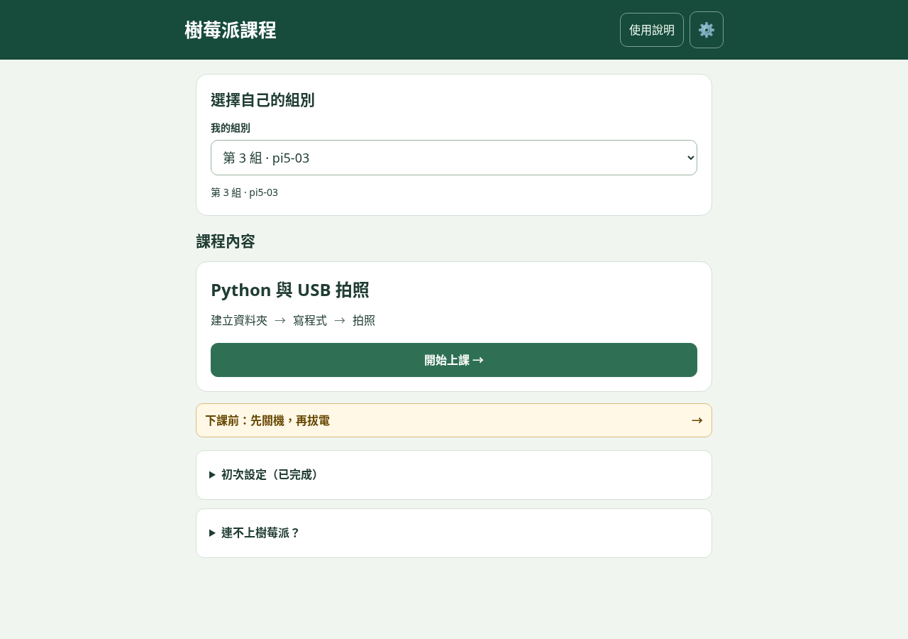

# 樹莓派 5 課堂小幫手

給第一次接觸 Raspberry Pi 的學生使用的繁體中文教學網站。先選組別，再進入 Python 與 USB 拍照課程；每次下課前另做正確關機。刷機、SSH 與遠端桌面等初次設定，集中在首頁收合區，需要時再開啟。老師可指定教學階段，助教可接收、接手並追蹤求助。學生操作頁先標示操作視窗、當前動作及預期結果；另可安裝 Pi 設備回報程式，讓助教查看實際服務與環境檢查。

[開啟課程首頁](https://ching-yu430.github.io/pi-helper/) · [教師功能介紹 PDF](docs/teacher-guide.pdf) · [可操作的工作台情境預覽](https://ching-yu430.github.io/pi-helper/workbench-preview.html) · [情境說明（模擬資料）](docs/WORKBENCH_EXAMPLES.md) · [更新紀錄](CHANGELOG.md) · [課前實機驗收](docs/CLASSROOM_CHECKLIST.md)



教學使用 Windows 筆電、Raspberry Pi 5 與各組手機熱點。Mac／Linux 使用者先請助教確認工具。Python 與 USB 拍照新增八階段教材及課程驗證；筆電辨識環境、相機串流與物品辨識仍待公布。

## 本機啟動

網站是原生 HTML、CSS、JavaScript，不需建置或安裝前端套件。使用 Python 3 與 Node.js 22 以上：

```sh
python3 -m http.server 8001 --bind 127.0.0.1
```

瀏覽器開啟 `http://127.0.0.1:8001/`。課堂組別、共用求助和老師指定步驟需要 Supabase；網路失敗時首頁會顯示重試與找助教提示，連線排查及靜態關機說明仍可閱讀。

## 部署 GitHub Pages

1. 將網站完整推送至 GitHub，保留 `assets/` 與 `.nojekyll`。
2. 儲存庫 **Settings → Pages** 選擇 **Deploy from a branch → main → / (root)**，儲存並等待 Pages 部署成功。
3. 新 Supabase 專案先執行下節安裝，再將 Project URL、publishable key（或 anon key）、公開課堂碼填入 [config.js](config.js)。既有部署沿用原設定。
4. 開啟課程首頁測試選組，用私下保管的密碼登入工作台，確認課堂開放及截止時間，再驗證求助、接手、學生確認與老師帶課。

`config.js` 只放公開連線資料。管理員密碼、service_role、secret key 與資料庫密碼不可提交 Git。工作台入口是首頁的 ⚙️；帳號管理在登入後的課堂設定。

## SQL 安裝與執行順序

在 Supabase SQL Editor 執行 [supabase/install.sql](supabase/install.sql)。新安裝與既有專案升級使用同一份檔案；它會依序執行尚未完成的 migration，整批成功才提交，並保留課堂、帳號及回報。請先備份正式資料庫。

只在**建立新課堂**時，接著執行 [supabase/create-classroom.sql](supabase/create-classroom.sql) 一次，保存輸出的管理員密碼，將學生課堂碼填入設定。升級既有課堂時不要執行建課檔。

來源集中在 [supabase/migrations/](supabase/migrations/)，編號為唯一順序：001 基礎 → 002 期限 → 003 課堂開關 → 004 回報 → 005 密碼 → 006 清除 → 007 組數 → 008 課堂功能 → 009 個人帳號 → 010 看板清除 → 011 暫停提示 → 012 健康檢查 → 013 設備回報 → 014 Python 與拍照課程 → 015 自動檢查開關 → 016 統一工具指派與核准 → 017 課程執行與重試紀錄。

安裝檔會記錄版本及 SHA-256 校驗碼，重跑會跳過已完成的版本，拒絕內容不符或較舊的安裝檔。日後以**新增編號 migration**升級，不修改已發布的來源。產生與檢查安裝檔：

```sh
node scripts/build-sql.cjs
node scripts/build-sql.cjs --check
```

[完整資料庫說明](docs/SUPABASE_SETUP.md) · [健康檢查排程](docs/SUPABASE_HEALTH_CHECK.md)。本次檔案整理沒有替正式資料庫執行 SQL。

## 工作台操作結果

看板優先顯示需要協助、操作失敗及狀態待確認的組別。按「查看本組」只讀取資訊；有求助時另顯示「處理求助」，需明確按接手才改變狀態。登入後可切換「詳細內容」，用組別選單查看任一組，也能從看板直接進入。本組頁面以左右配置的操作／狀態／回報時間呈現，清單用底色及文字凸顯目前回報項目，求助、設備資訊和學生網頁回報各自收合。

執行紀錄需先在 Supabase SQL Editor 執行同一份最新 [supabase/install.sql](supabase/install.sql)（含 017），不需重裝 Pi 工具。開始記錄之後每項操作保留最近 10 次執行，已有舊結果保留但不補造開始時間。未升級時仍可查看最新結果，頁面會提示重試紀錄尚未啟用。

目前工具回報的是指定課程檢查，尚未回傳每一條終端機指令。`mkdir`、`cd`、`ls`、取得拍照程式及 Windows 下載會明確標示沒有獨立回報；資料夾檢查成功不等於能證明這三行已執行。學生確認照片品質及下載也不算 Pi 驗證。完整範圍與後續課程接入規則見 [工作台操作紀錄](docs/COURSE_MONITOR.md)。

## Pi 設備回報

執行最新 SQL 升級後，在工作台「課堂設定 → 樹莓派設備回報」逐組產生安裝設定碼，依畫面指示在該組 Pi 的 SSH 視窗下載、安裝程式。Pi 每 30 秒回報主機名稱、SSH／xrdp、套件、X11 設定、Python、USB 相機及可用空間，與學生自行回報的學習進度分開顯示。

超過 90 秒未收到資料只顯示「暫無回報」，不判定關機或故障；尚未安裝時可繼續原本教學。不收集畫面、檔案、Wi-Fi 密碼或完整日誌，也不提供遠端執行指令。正式資料庫升級與真實 Pi 安裝需由課堂管理者完成，詳見 [設備回報安裝與排查](docs/DEVICE_MONITOR.md)。

## 測試

設備與課程工具現在可由後台統一指派，一次核准及安裝，後續沿用同組配對。詳見 [統一工具指派與安裝](docs/CLASSROOM_TOOLS.md)；需先執行含 016 的最新 SQL 更新。

新課程的設定、已驗證範圍與現場驗收項目見 [Python 與拍照課程說明](docs/CAMERA_COURSE.md)。執行最新 SQL、在 Pi 的 user 帳號設定課程工具後，會建立短指令 `~/pi-course`。拍照程式維持 720P 預覽、拍照切換 1080P；新介面與 Windows 下載仍需實機驗收。新課程預設關閉，由老師驗收後開放。工作台「課堂設定 → 學生進度」可選擇自動檢查，預設關閉；手動模式不需要設備回報就能下一步。共用開關需安裝最新 SQL（含 015），舊資料庫先採手動模式，後台提供同一份安裝檔的下載與複製。

快速檢查不需額外套件：

```sh
node tests/run-tests.cjs
node scripts/build-sql.cjs --check
node scripts/version-assets.cjs --check
```

本機 CSS／JavaScript 在每個 HTML 頁面使用同一個依內容產生的版本號。修改這些資源後執行 `node scripts/version-assets.cjs`，再提交更新後的 HTML；CI 會檢查有沒有漏更新。

資料庫測試使用隔離的 PGlite，不寫入正式課堂：

```sh
npm install --prefix /tmp/pi-test @electric-sql/pglite@0.5.10
export PGLITE_ROOT=/tmp/pi-test/node_modules/@electric-sql/pglite
node tests/run-install-sql.cjs
node tests/run-learning-sql.cjs
node tests/run-workbench-sql.cjs
node tests/run-presenter-sql.cjs
node tests/run-device-sql.cjs
node tests/run-camera-sql.cjs
python3 -m unittest discover -s tests -p test_device_agent.py -v
```

拍照程式測試使用合成影像做真正 JPG 編解碼，開發測試相依套件不安裝到 Pi：

```sh
python3 -m pip install --target /tmp/pi-camera-python -r tests/requirements-camera.txt
PYTHONPATH=/tmp/pi-camera-python python3 -m unittest discover -s tests -p test_camera_course.py -v
```

瀏覽器測試另需 Playwright 與 Chromium，並保持本機伺服器運行：

```sh
npm install --prefix /tmp/pi-test playwright@1.62.1
export NODE_PATH=/tmp/pi-test/node_modules
export PI_HELPER_TEST_URL=http://127.0.0.1:8001/
node tests/run-home-fallback-browser.cjs
node tests/run-home-layout-browser.cjs
node tests/run-clear-board.cjs
node tests/run-teacher-follow-browser.cjs
node tests/run-projection-browser.cjs
node tests/run-presenter-tools-browser.cjs
node tests/run-command-copy-browser.cjs
node tests/run-device-browser.cjs
node tests/run-camera-browser.cjs
```

瀏覽器腳本預設 `/usr/bin/chromium`；新入口測試也接受 `CHROMIUM_PATH`。可由系統套件管理員安裝 Chromium。測試涵蓋斷線／逾時／重試、組別延遲回應、老師指定步驟、求助流程、圖片標記和全螢幕版面。每次 push 與 PR 都會由 [Website checks](.github/workflows/tests.yml) 執行快速檢查、SQL bundle 檢查及隔離安裝測試。

自動測試不能代替實體裝置驗收。正式上課前請依 [實機清單](docs/CLASSROOM_CHECKLIST.md)，使用真實手機、Windows 筆電及 Pi 5 走完整流程。

## 文件與授權

- [教材圖片來源](docs/SOURCES.md)、[Imager 圖片](assets/imager/SOURCES.md)、[操作圖片與素材授權](assets/operations/SOURCES.md)。
- [歷史驗證紀錄](docs/AUDIT.md) 與 [更新紀錄](CHANGELOG.md)。
- [GitHub About 建議設定](docs/GITHUB_ABOUT.md)。

目前尚未選定程式碼開源授權，暫不新增 LICENSE；公開儲存庫不代表已授予自由再利用權利。第三方圖片沿用各自來源與授權說明。
