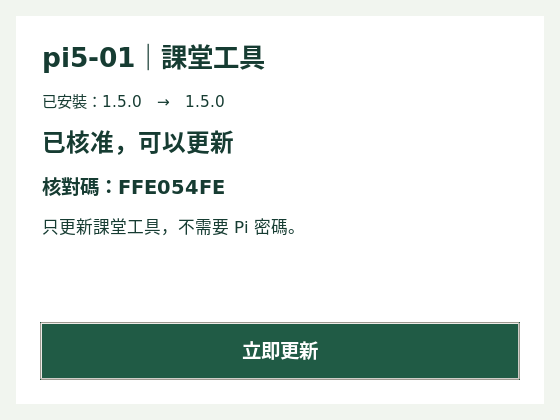

# 課堂工具：指派、核准與統一安裝

同一次安裝／更新涵蓋背景設備回報、user 帳號的課程工具及拍照程式。沿用目前的服務與 `~/pi-course` 路徑，既有教材指令不變。這是安裝流程的整合；背景服務與學生程式仍分開使用最低需要的權限。

## 首次啟用

1. 資料庫管理者在 Supabase SQL 編輯器執行最新的 [supabase/install.sql](../supabase/install.sql)，含 022；目前選 1.5.0。既有課堂、帳號、進度、設備及課程紀錄保留。
2. 登入工作台，開啟「課堂工具 → 指派安裝／更新」，勾選組別及版本，按「指派安裝／更新」。可一次選取全班。
3. 學生在首頁選自己的組別，按「安裝課堂工具」提出申請，畫面顯示組別與核對碼。
4. 老師／助教可以在學生頁輸入自己的後台密碼核准，也可以在自己的手機開啟 [課堂工具頁](https://ching-yu430.github.io/pi-helper/assistant.html?view=classroom-tools)，登入後會直接進入上方「課堂工具」分頁；核對該組核對碼後按「核准安裝」。前者不建立或保存學生瀏覽器的後台登入。
5. 學生複製本組的一行指令，在樹莓派遠端桌面的終端機用 user 執行。不要在整行前加 sudo；程式需要安裝服務時，會另外要求 Pi 的 sudo 權限，此時使用 Pi 密碼。
6. 看板依序顯示等待申請、待核准、待安裝、安裝中、已完成／失敗。收到本次設備回報及位置檢查結果後，才記為安裝完成。

若尚未更新資料庫，指派區會提供同一份 SQL 更新檔的複製及下載。既有設備與課程回報繼續工作；學生首頁不會出現無法使用的安裝入口。

手機的課堂工具頁即使沒有待核准申請，也會顯示空白狀態說明與「前往指派組別」。要產生核准卡片，仍須先指派組別，且學生已按「安裝課堂工具」提出申請。核准後的任務移至「已核准與其他任務」，避免重複核准。

## 桌面更新（1.5.0 之後）

上圖為真實 Tk 視窗的離線模擬畫面，同版更新也能修復工具；未連接學生設備。

第一次升級到 1.5.0 仍使用上方的一行指令。安裝完成會新增 Pi 桌面「課堂工具」、程式選單入口及登入後的更新提醒。只更新網站說明不必更新 Pi；修改 Pi 的工具程式時，發布新版再由老師指派。

1. 老師在網頁「課堂工具」勾選組別，指派新版。
2. Pi 桌面約 30 秒內顯示提示；學生也可直接雙擊「課堂工具」。首頁選本組後會顯示「查看工具更新」。Pi 必須已登入桌面且能連線，關機或離線時等恢復後再提示。
3. 學生在 Pi 按「申請更新」，畫面顯示核對碼。助教從自己的手機／工作台核准；也可在學生網頁輸入後台密碼。
4. 學生回 Pi 按「立即更新」。一般課程工具更新不問 Pi 密碼；若設備服務內容、系統版本條件或配對需要變更，會跳出 **Pi 密碼**視窗。沒有把後台密碼傳到 Pi。
5. 網頁約每 5 秒同步等待、已核准、更新中、失敗或完成。完成仍須伺服器收到本次設備與課程位置兩項真實回報，通常另需等一輪 30 秒設備回報。
6. 成功後關閉視窗，繼續上課。更新時視窗會阻止誤關閉；不會自動重開機或在背景擅自換掉學生正在使用的程式。

如果已在網頁先提出指令申請，再改到 Pi 桌面申請，舊核准會失效，必須讓助教核對**新的核對碼**。已領取的另一筆安裝不能直接接手。首次安裝失敗可沿用原指令重試；已具桌面工具的更新失敗則在同台 Pi 按重試。超過授權時間，請助教重新指派。

桌面提示需要圖形桌面登入；只有 SSH 時不會顯示彈窗。若桌面圖示第一次詢問是否允許執行，選擇允許；也可由程式選單開啟。安裝缺少 Tkinter 時會透過 apt 安裝 python3-tk，需有可用的 Pi 網路及 sudo 權限。系統服務的重大變動仍應先在 pi5-10 驗收。

更新以 user 權限下載核准版本，檢查安裝器與全部元件 SHA-256。課程元件以新目錄準備完成後切換，保留舊工具；設定／啟動失敗會復原先前程式檔。系統套件及 root 服務不宣稱完整回滾。若已進入雲端完成確認後斷線，保留新版供重試，避免伺服器已接受完成卻回復舊版。學生作業、照片及待送事件不在工具版本目錄內。

新增桌面 API 只接受既有有效課程憑證與正確主機名稱。免 sudo 更新只在設備元件 SHA-256 和 system_revision 都與已安裝版相同、且沒有重新綁定時開放。此 API 不會回傳 root 設備憑證。更換系統需求時，發布版本必須增加 system_revision；變更設備來源的 hash 也會自動改走系統更新。

## 已有設備與後續課程

- 安裝工具會讀取既有的兩份配對設定，向伺服器核對。合法設定沿用原憑證、課程序號及未送事件，不用重新貼設定碼。
- 同一次更新不會刪除 `pi-camera`、照片、hello.py 或學生作業。
- 本機設定遺失或與後台不符時，停止並要求助教確認，不會偷偷撤銷正在使用的配對。
- 確定要替換設備或重刷後，才在進階選項勾選「重新綁定」。領取時舊憑證失效；雲端紀錄與 Pi 照片保留，但舊憑證的本機未送事件不能繼續使用。
- 原本兩個個別安裝入口收在「舊版個別工具設定」，只供相容與排查；正常使用統一指派即可。
- 後續課程的新工具放進下一個工具版本，再指派同一組更新；不需每課新增一套配對或安裝設定碼。新套件仍須實際安裝，不能只靠網站宣告完成。

## 授權與失敗處理

學生申請密鑰由瀏覽器產生，只在該瀏覽器暫存最多 20 分鐘。資料庫只保存雜湊與核對碼；其他瀏覽器不能只憑組號領取指令。核准後 10 分鐘內可首次領取；第一次領取綁定該安裝端的隨機密鑰，另一端不能重用。主機名稱不符時，領取前就停止。

已領取的同一個安裝端有一小時重試期，防止網路中斷後必須反覆配對。請在同一台 Pi 重試：首次安裝重跑原指令，桌面更新則按「立即更新」。老師取消或重新指派會立即使舊授權失效；取消不會自動卸載已寫入 Pi 的檔案，也不會撤銷原有回報憑證。核准到期可重新核准；沒有原瀏覽器或需重設申請時，由老師重新指派。

安裝檔及每個元件都比對 SHA-256；下載全部驗證成功後才更新程式。後台密碼不會送到 Pi，也不會寫進指令、設定檔或安裝紀錄。長期設備／課程憑證只交付給成功領取的安裝端，不回傳到學生或教師的任務列表。

這些限制用於防止誤組與誤安裝，不是防作弊或不可偽造的硬體身分驗證。網站不會因學生按下一步而偽造設備完成，也不會開放任意遠端指令。

## 發布新的工具版本

`tooling/releases/1.0.0/`、`1.1.0/`、`1.2.0/`、`1.3.0/` 、`1.4.0/` 與 `1.5.0/` 是固定版本的安裝包，舊指派不會隨 main 上的新課程改變。`tooling/release.json` 描述目前版本；SQL 中的版本目錄決定老師能指派的版本。

1. 修改來源工具並通過測試。
2. 新增下一份編號 migration，包含 begin／commit 與 `-- RELEASE_SEED` 標記；不要修改已發布的 016 或既有版本目錄。
3. 例如：`node scripts/build-tool-release.cjs --version=1.6.0 --migration=023_tool_release.sql`。產生新版本安裝包、校驗碼及 SQL 版本資料。若系統需求改變，另加 `--system-revision=3`（1.5.0 為 2，之後持續遞增）；只有課程工具改變則沿用目前值。
4. 執行 `node scripts/build-sql.cjs`、`node scripts/version-assets.cjs`，提交並部署程式與資料庫更新。
5. 老師選新版指派更新，同一組沿用既有配對。

CI 檢查版本目錄、來源、校驗碼與 SQL 目錄是否一致。

## 現場驗收

目前自動測試包括隔離 PostgreSQL、瀏覽器與模擬安裝；沒有代替真實 Pi 驗收。先用測試課堂及一台 Pi 確認：

- [ ] 從沒有配對的 Pi 安裝，兩項回報及開機後背景服務正常。
- [ ] 從只安裝舊設備回報、以及兩項皆已安裝的 Pi 更新；舊憑證及待送序號保留。
- [ ] 安裝中斷後在同一台重試，其他 Pi 或錯組名稱不能領取。
- [ ] 開機服務使用專用受限帳號；學生程式與照片由 user 擁有。
- [ ] 學生密碼核准與助教手機核准皆可用，關閉對話框後沒有學生端後台登入。
- [ ] 更新後仍能執行原有課程、開啟遠端桌面與拍照。
- [ ] pi5-10 從舊版升到 1.5.0 後，桌面與程式選單有「課堂工具」，登出／重新登入仍會提示更新。
- [ ] 手機核准 Pi 桌面申請後，學生無需終端機即可完成同版修復或下一版課程更新。
- [ ] 一般課程更新免 Pi 密碼；系統更新會出現 Pi 密碼視窗，輸錯／取消可安全重試。
- [ ] 取消指派、斷網、核准到期、另一個安裝端搶先領取都有清楚提示。

## Python 編輯器

學生在 Pi 遠端桌面使用 Thonny 寫程式與存檔，再回 Pi 終端機執行網頁提供的 `~/pi-course hello`／`write`，維持實際執行檢查與後台回報。不要以 Thonny 的 F5 執行代替課程工具回報。

上課前助教先確認選單可開啟 Thonny；未安裝時，「課堂工具 → 上課前確認 Thonny」提供 `sudo apt install -y thonny`。這是現場準備指令，已發布的工具 1.0.0 保留；新版 1.1.0 加入學生 AI 拍照程式的執行與結果檢查，也不宣稱已驗證各組安裝或 OS 選單。既有 `view=install-approvals` 網址仍可開啟同一分頁。

## AI 拍照程式檢查（1.1.0）

先執行最新 SQL 安裝檔（含 018），再指派 1.1.0 更新既有 Pi。學生自己的 `pi5-組號_camera.py` 不會被更新工具覆寫。`~/pi-course camera-student` 不安裝範例程式，只執行本組檔案，結束後檢查新照片及相機可再次取像。舊版 `camera-install`／`camera` 留供相容，不會替新版作業新增成功。

程式執行期間約每 30 秒回報執行中，照片結果在結束後回傳；關掉課程網頁不會停止 Pi 程式。這不是逐行監控 Python，也不會在後台自動顯示預覽或照片影像。詳見 [課程設計](CAMERA_COURSE.md)。

## OpenCV 與相機逐項回報（1.2.0）

最新 SQL 安裝檔含 019；更新後指派同一套課堂工具 1.2.0。可從 1.0.0／1.1.0 直接更新，配對、序號、照片與學生程式保留。新 run 前綴只接受教材列出的固定 apt、Python 載入與 v4l2 唯讀查詢，不接受任意指令、額外套件或 set-ctrl。後台新增 OpenCV、相機清單、解析度及設定四項獨立紀錄，原本 update／install 保留。詳細流程見 [課程](CAMERA_COURSE.md)。

## 本組程式路徑（1.3.0）

最新 SQL 安裝檔含 020，版本目錄加入 1.3.0；不更改事件格式、驗收或配對。指派更新後，教材明列並執行 `/usr/bin/python3 /home/user/pi-camera/pi5-組號_camera.py`，前面沿用 `~/pi-course run --` 以保留檢查及回報。只接受與本機組別相符的指定程式，不接受任意腳本或額外參數。舊 camera-student 指令仍可使用。

## 1.4.0 安裝修正與復原

已確認 1.0.0～1.3.0 的安裝器會由 sudo 子程序以 importlib 載入學生暫存目錄的 device.py，Python 因而建立 root:root、755 的 __pycache__。user 在 TemporaryDirectory 收尾時無法刪除其中的 pyc，安裝在執行 location 及完成驗證之前中斷。重跑相同指令會再次建立快取，1.3.0 與 1.2.0 的安裝器相同。

1.4.0 在動態載入期間禁止寫入 bytecode，並以 -B 啟動 sudo Python。相同權限測試已在離線隔離容器實際以 root 載入、UID 1000 清理，重現舊版失敗並確認修正版成功。GitHub CI 也執行這項測試，測試只建立暫存假模組，不安裝服務或連接正式資料庫。

復原：

1. 資料庫執行最新 install.sql，包含 021；不重建課堂。
2. 重新整理工作台，指派原組別 1.4.0，不勾「重新綁定」。
3. 學生在首頁選該組，重新申請／核准，複製新指令到原 Pi 執行。舊版指令不再重跑。
4. 等到終端機顯示「設備與課程回報都已收到」，且網站為已完成。

舊的 root 暫存快取不需手動刪除才能更新；新安裝使用新的暫存目錄，修正版會正常清理。相片、學生程式、既有憑證與待送事件保留。設備服務啟動訊息不再宣稱已送出第一筆回報，最終成功仍須伺服器收到兩項實際回報。等待確認時會再次補送課程待送資料，並有進度提示，不把等待直接當成功。

失敗會顯示階段，後台保存限定的錯誤代碼；本機安全摘要在 `~/.config/pi-helper-install/last-error.json`。可將這個摘要交給助教，勿貼安裝指令內的申請密鑰或配對設定。摘要只含階段、錯誤類別、errno、結束碼與時間，不包含票證、憑證、HTTP 原文或原始子程序參數。
