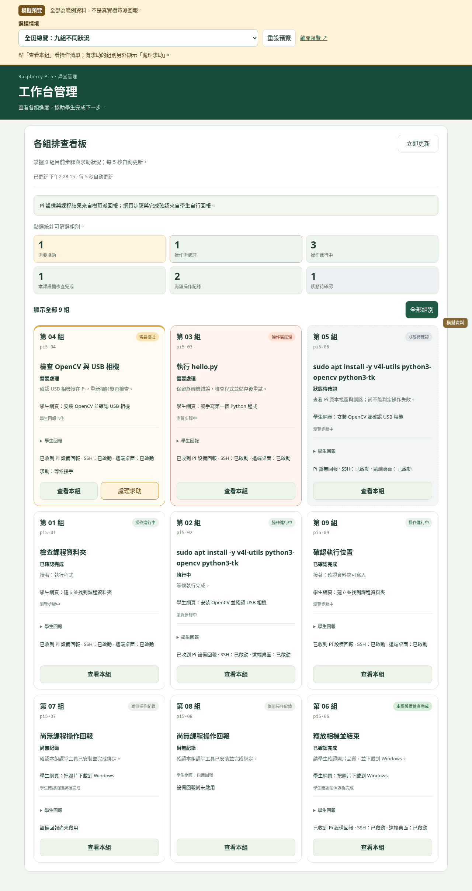
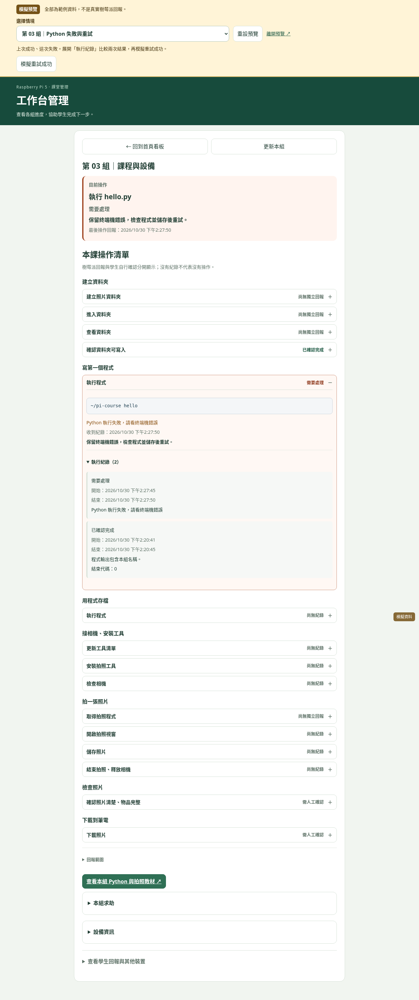

# 工作台情境預覽

[開啟可操作的預覽](https://ching-yu430.github.io/pi-helper/workbench-preview.html)。不需樹莓派、登入密碼或 Supabase 更新。

**全部為模擬資料，不是真實 Pi 的測試成果。** 預覽使用與正式工作台相同的畫面程式，回報資料與求助狀態只存在這個預覽頁的記憶體。頁面不載入正式 Supabase 設定或連線程式，並用 CSP 禁止資料連線；重新整理會還原情境。

## 建議先試這四個情境

1. [Python 失敗與重試](https://ching-yu430.github.io/pi-helper/workbench-preview.html?scenario=3)：展開「執行紀錄」，比較過去成功與最新失敗；按「模擬重試成功」，再看結果與紀錄改變。
2. [相機問題與求助](https://ching-yu430.github.io/pi-helper/workbench-preview.html?scenario=4)：查看本組不會接手。展開本組求助，按接手，再按「請學生再試一次」及上方「模擬學生確認解決」。也可以先模擬接回相機，觀察設備通過並不會自行結束求助。
3. [回報中斷](https://ching-yu430.github.io/pi-helper/workbench-preview.html?scenario=5)：看到的是「狀態待確認」，不是失敗或關機；可模擬恢復。
4. [拍照課檢查完成](https://ching-yu430.github.io/pi-helper/workbench-preview.html?scenario=6)：查看照片名稱、尺寸及正常結束結果；照片品質和 Windows 下載另標學生自行確認。

上方選單另有資料夾成功、套件安裝中、只有自行確認、尚無紀錄及剛安裝課堂工具等情境。「重設預覽」會還原所有模擬操作；「離開預覽」才回到正式工作台。





## 回報的實際範圍

此頁用範例資料展示介面，不會替目前工具新增監控能力。mkdir、cd、ls 仍標示「尚無獨立回報」。可顯示的設備及課程證據、逐行回報的限制，以及正式環境的 SQL 更新，見 [工作台操作紀錄](COURSE_MONITOR.md)。

## 維護與測試

`workbench-preview.html` 由正式 assistant.html 產生，改用 workbench-preview.js 的本機模擬介面；CSS 與看板、設備、課程和求助元件仍共用正式來源。更新正式頁面後執行：

```sh
node scripts/build-workbench-preview.cjs
node scripts/version-assets.cjs
node scripts/build-workbench-preview.cjs --check
```

本機網站啟動後，使用 Playwright 與 Chromium 測試九組情境、重試、求助完整流程、直接連結、重設及手機排版；測試攔截所有外部 HTTPS，確認沒有正式資料連線：

```sh
PI_HELPER_TEST_URL=http://127.0.0.1:8021/ node tests/run-workbench-preview-browser.cjs
```

加上 `PI_HELPER_CAPTURE_PREVIEW=1` 會更新本文件兩張標示模擬資料的截圖；也可沿用 `node scripts/capture-workbench-demo.cjs`。截圖是瀏覽器實際渲染結果，內容仍是模擬資料。
