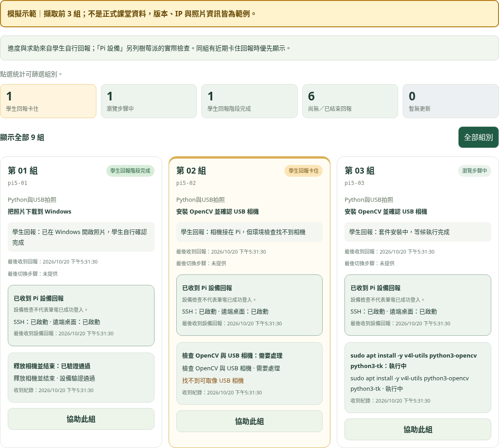
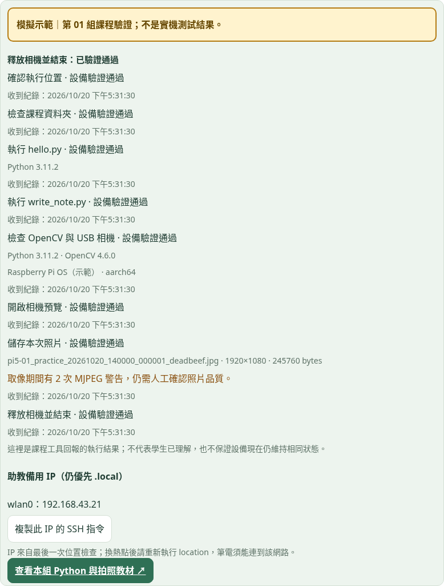
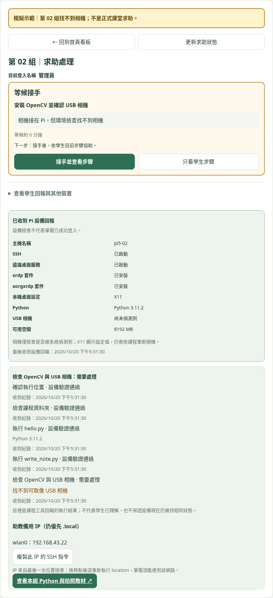

# 工作台收到 Pi 回報後的畫面

以下使用實際網站介面與隔離資料庫產生，**全部為模擬資料，不是真實 Pi 測試結果**。組別情境、IP、套件版本、照片資訊與時間都是範例；沒有寫入正式課堂。

## 看板總覽



- 第 01 組：學生自行確認完成；課程工具另有預覽、照片及正常結束的通過紀錄。
- 第 02 組：學生求助，環境檢查回報找不到 USB 相機。
- 第 03 組：套件安裝執行中，等候後續回報。

上方統計與組別標籤來自學生網頁回報；「Pi 設備」與課程結果分開呈現。學生按完成，不會替設備新增驗證通過紀錄。

## 點進組別：查看實際結果



實際能看到的資料包括：

| 項目 | 工作台顯示內容 |
| --- | --- |
| 背景設備回報 | 主機名稱、SSH／遠端桌面服務、套件、X11 設定、Python、USB 相機數量、可用空間與最後回報時間 |
| 課程工具回報 | 位置與資料夾檢查、hello.py／write_note.py 執行結果、安裝狀態、OpenCV 與相機檢查、預覽、拍照及正常結束 |
| 拍照成果 | 本次照片檔名、實際尺寸、檔案大小、可讀性驗證、MJPEG 警告次數；不顯示照片內容 |
| 備用 IP | 最後一次位置檢查回報的區域網路 IPv4，可複製 SSH 指令；仍優先使用 .local |
| 錯誤 | 例如找不到程式、組別文字不符、套件安裝失敗、相機沒有影像、照片尺寸不符等摘要 |

這是課程工具範圍內的執行結果；不包含學生所有指令、完整終端機歷史、桌面畫面或相機即時影像。照片清晰度與 Windows 是否已下載開啟，仍需學生自行確認。

## 有問題：查看求助與檢查結果



助教點進該組，先看求助內容，再核對設備與課程檢查結果，接手後協助學生重試。上次通過的結果不保證設備目前仍維持相同狀態。

SQL 更新完成後，仍需在 Pi 安裝背景設備回報與 user 身分課程工具，才能出現以上資料。背景設備約每 30 秒回報；課程工具在執行指定操作時回報，長時間套件工作另有進行中回報。超過 90 秒未收到資料只表示待確認，不會判定設備已關機或故障。

## 重產示意圖

依 README 安裝 Playwright、Chromium 與 PGlite，啟動本機網站後執行：

```sh
PI_HELPER_TEST_URL=http://127.0.0.1:8001/ PGLITE_ROOT=/tmp/pi-test/node_modules/@electric-sql/pglite node scripts/capture-workbench-demo.cjs
```

腳本會將 Supabase 請求導向暫存記憶體資料庫，只將三張標示模擬的圖片寫入 assets/screenshots，不操作正式 Supabase。
